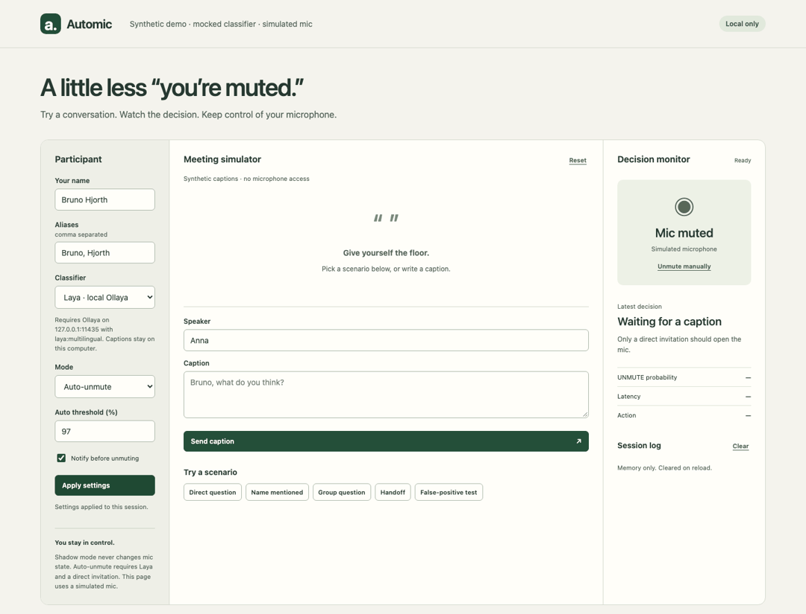

# Automic

**Your mic knows when it’s your turn to talk.**

A local-first Chrome extension for Google Meet. Automic watches live captions, looks for a direct invitation to your configured name, and asks a local Laya classifier whether it is your turn. Start in shadow mode, inspect its decisions, then opt into notifications or automatic unmute.

**Experimental v0.1.** Automatic microphone control is implemented with strict guards. Google Meet changes its DOM frequently; the adapter is tested against fixtures, and live Meet compatibility must be verified on your account. The base Laya model is not a calibrated turn-taking model: high recall and a low false-unmute rate are not established. Keep shadow mode enabled until you have evaluated it on your meetings.



## Try the simulator

Requires Node.js 22 or newer.

```sh
npm ci
npm run build
npm run dev
```

Open [the local simulator](http://127.0.0.1:4317). It starts with a **rules demo** and a simulated microphone; it never requests microphone access. Try direct questions, third-person mentions, group questions, handoffs and a false-positive sequence. Rules scores are heuristic, not measured probabilities, and rules never authorize automatic unmute.

## Run local Laya

Install [Ollaya](https://ollaya.dev/docs/quickstart), then:

```sh
ollaya pull laya:multilingual
ollaya serve
```

The classifier uses Ollaya’s [native decision API](https://ollaya.dev/docs/api) on `http://127.0.0.1:11435`. Ollaya is a separate decision-model runtime; this is not Ollama's chat API. No model weights are bundled here. The simulator’s local server proxies this fixed loopback endpoint; it does not forward captions to a remote service.

Choose **Laya · local Ollaya** in the simulator and apply settings. Cold model loading may exceed the request timeout; warm the model first:

```sh
ollaya run laya:multilingual "warm up"
```

For the extension, allow its origin if Ollaya rejects browser requests. Get the extension ID from `chrome://extensions`, stop your own Ollaya process, then restart it with:

```sh
OLLAYA_ORIGINS="chrome-extension://YOUR_EXTENSION_ID" ollaya serve
```

Use this specific origin rather than a wildcard. If the model is unavailable, truncated, malformed or too slow, Automic stays muted and reports the error.

## Install in Chrome

1. Build with `npm run build`.
2. Open `chrome://extensions` and enable Developer mode.
3. Choose **Load unpacked** and select `dist/extension`.
4. Open the popup; enter your name and aliases. Keep **Shadow** selected.
5. Join a Google Meet meeting and turn **captions on** in Meet.
6. Inspect the in-meeting indicator and debug log before enabling Auto-unmute.

The extension supports English and Swedish microphone labels. It only acts after it finds a leave-call control and a uniquely identifiable muted microphone control. It will not click when status is unknown, in the lobby, or if already unmuted. Unexpected Meet markup results in no action; see [adapter notes](docs/meet-adapter.md).

## Modes and action policy

| Mode | Behavior |
|---|---|
| Off | Ignore captions and cancel pending work |
| Shadow (default) | Show what would happen; never click the mic |
| Notify only | Show a possible invitation; never click the mic |
| Auto-unmute | Laya-only; direct named invitation in latest caption; raw UNMUTE probability at least 0.97; known muted state |

The configurable auto threshold has a 0.97 floor. A model score is not an accuracy guarantee. Notifications provide a cancellable grace period when enabled. New captions, setting changes, stop/cancel and leaving the meeting invalidate pending work. Results expire; duplicates, self captions and cooldown prevent repeated actions. **There is no automatic mute.**

## Privacy and permissions

- No audio capture, recording, analytics, cloud inference or account connection.
- Meet captions already originate in Google Meet; Automic's own inference runs locally.
- Settings are stored locally. The engine keeps up to four captions for inference and up to 50 diagnostic events in memory (including caption text). The visible debug log keeps ten events. These are cleared on reload/end of session; no transcripts are written to disk.
- The extension needs `storage`, access to `meet.google.com`, and access to the fixed local Ollaya endpoint. It does not request microphone, tabs or browsing-history permissions.
- Treat local-model output as untrusted. A second deterministic action gate applies even after a high-confidence model result.

## Development and evaluation

```sh
npm run check
npm test
npm run build
npm run eval
npx playwright install chromium
npm run test:e2e
```

The rules evaluation is a synthetic regression suite, not a trained-model benchmark. To evaluate the actual local pipeline with Ollaya, run `npm run eval -- --ollaya`. Validation results and limits are in [validation notes](docs/validation.md).

```text
core/        settings, candidate filter, rules, Ollaya, safe turn engine
extension/   Meet DOM adapter, content script, service worker, popup
simulator/   synthetic conversations and simulated microphone
eval/       Swedish/English labeled regression cases and runner
tests/      policy, adapter, and browser tests
```

Next: collect opt-in labeled examples, measure false unmute and recall, specialize/calibrate a model, then consider additional meeting platforms. Whisper, fine-tuning and automatic mute are outside v0.1.

MIT licensed. Laya and Ollaya are separate projects with their own licenses.
