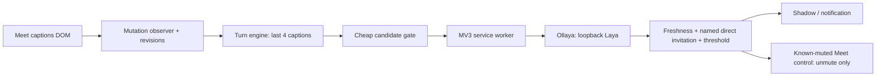

# Architecture

The shared core has no Chrome or Meet dependency. `Caption` is its input, `Classifier` is asynchronous inference, and `MeetingController` is the sole action adapter. The simulator uses the same engine and classifier, replacing Meet with synthetic captions and an in-memory mic.

Meet is an untrusted DOM input. The content script reads bounded caption regions and sends local inference requests through its own background service worker. The background worker validates sender, payload and persisted settings; the Meet page cannot select an arbitrary inference URL. Only loopback Ollaya is allowed.

The engine cancels superseded requests, deduplicates caption revisions and rechecks the current meeting/mic immediately before an action. The extension never toggles mute blindly. Model errors, stale context, ambiguous controls and low confidence fail closed. The model is advisory: even a high score is insufficient without the latest direct name cue.

Builds bundle all JavaScript locally. There are no remote scripts, telemetry libraries or backend accounts. Inference only transmits the short caption context to the locally configured runtime.
